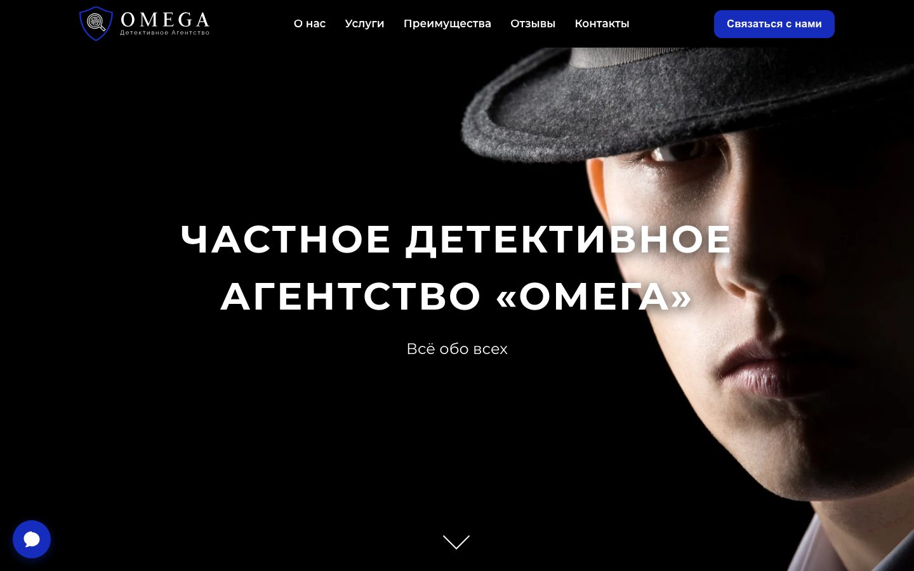
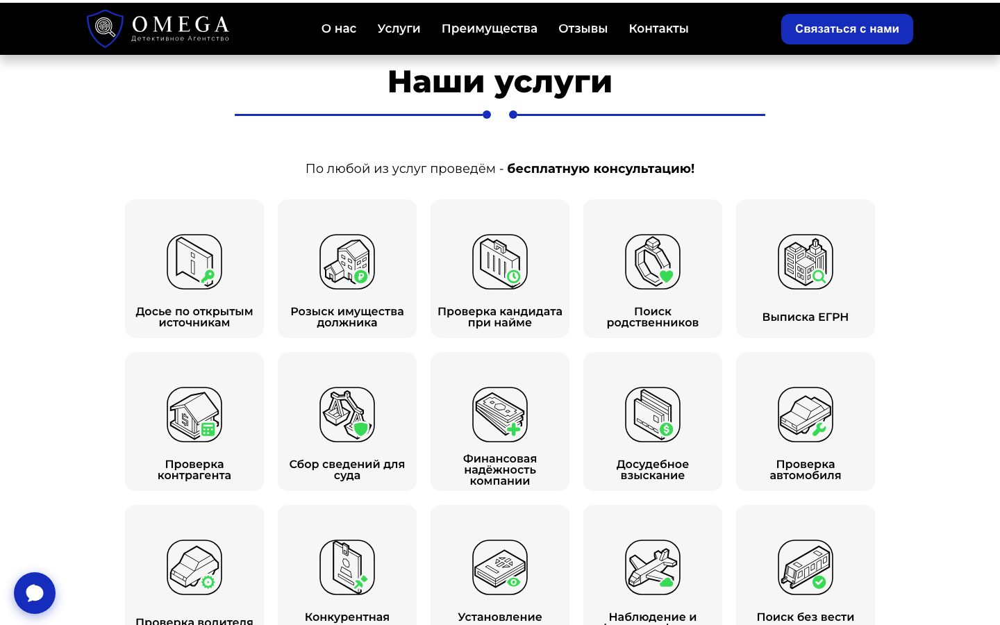
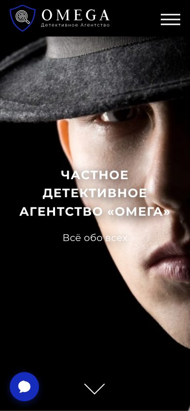

# OMEGA — лендинг детективного агентства

[](https://omegadet.vercel.app/)

Одностраничный сайт-визитка с адаптивной вёрсткой, написанный с нуля: без CMS, сборщиков, препроцессоров и фреймворков. Коммерческая работа 2024 года, переведённая в демонстрационный режим.



## Технологии

- **HTML5 / CSS3** — CSS-переменные, flex, `scroll-snap`, `clamp()`, `dvh` и `env()` для iOS
- **Vanilla JavaScript** — без jQuery и фреймворков, ~250 строк
- **Vercel** — статический хостинг

Весь сайт — один файл `index.html`: разметка, стили и скрипты. JS-зависимостей нет вообще — из внешнего только Google Fonts. Карусель отзывов раньше работала на Swiper 11; библиотека занимала ~170 КБ с CDN ради стрелок и переехала на нативный `scroll-snap`.

## Что внутри

| Блок | Реализация |
|------|-----------|
| Hero | Фон через `<picture>` с раздельными вариантами под десктоп и мобильные, `fetchpriority="high"` |
| Услуги | 17 карточек с переворотом; выбранная услуга подставляется в форму через `data-service` |
| Отзывы | Карусель на CSS `scroll-snap`: 1 / 2 / 3 карточки по ширине экрана, свайп и клавиши работают нативно, JS — только кнопки и блокировка на краях |
| Форма заявки | Модальное окно с валидацией, focus-trap, honeypot от ботов |
| Мессенджеры | Плавающий FAB с раскрывающимися контактами |
| Меню | Бургер с `translateX`-анимацией и корректным поведением фокуса |

<p align="center">
  
  
</p>

## Доступность и производительность

- Кольцо фокуса на `:focus-visible`, skip-link, корректные `aria-expanded` / `aria-labelledby`
- Карточки раскрываются и по `:focus-within` — интерфейс проходится с клавиатуры целиком
- Закрытое мобильное меню убрано из tab-order, модалка удерживает фокус внутри
- Контрастность текста соответствует WCAG AA
- Учитывается `prefers-reduced-motion`
- Единый источник блокировки прокрутки — меню и модалка не конфликтуют
- Адаптив проверен на 480 / 768 / 800 / 900 / 1024 / 1440 px, горизонтального переполнения нет
- Ноль JS-библиотек: ничего не грузится с CDN, кроме шрифта

## Форма заявки

Форма работает в демо-режиме: проходит валидацию и показывает подтверждение, но письмо не отправляется. В рабочей версии стоял [Web3Forms](https://web3forms.com); переключатель `DEMO_MODE` в конце `index.html` возвращает реальную отправку.

## Локальный запуск

Сборка не нужна — достаточно любого статического сервера:

```bash
python3 -m http.server 8000
```

## Заметка

Название агентства, контакты, отзывы и цены вымышлены. Перечень услуг составлен по ст. 3 Закона РФ № 2487-I «О частной детективной и охранной деятельности». Сайт закрыт от индексации метатегом `noindex`, чтобы не пересекаться в выдаче с реальными организациями.
